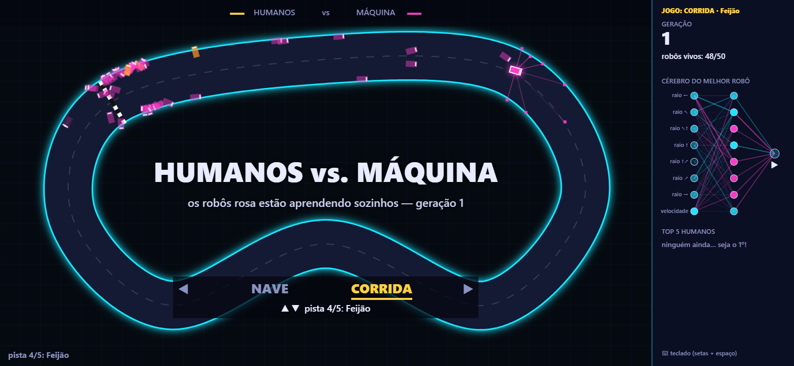
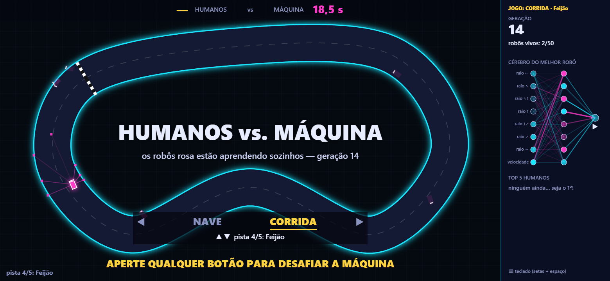
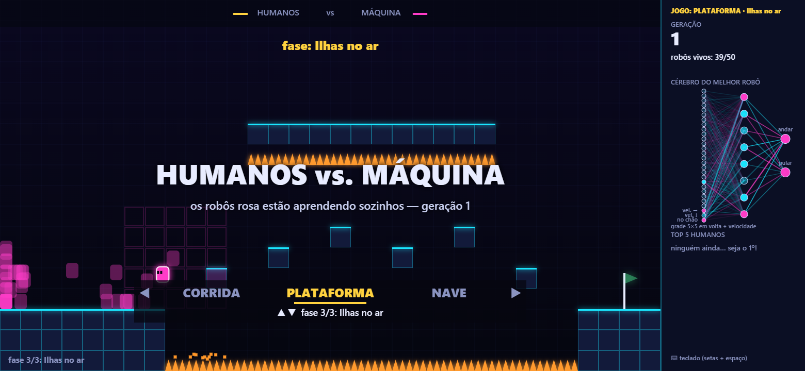
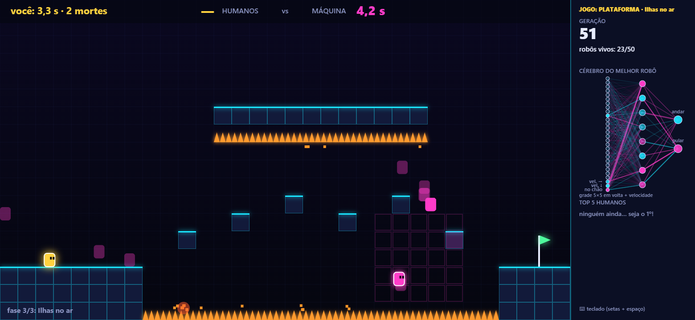
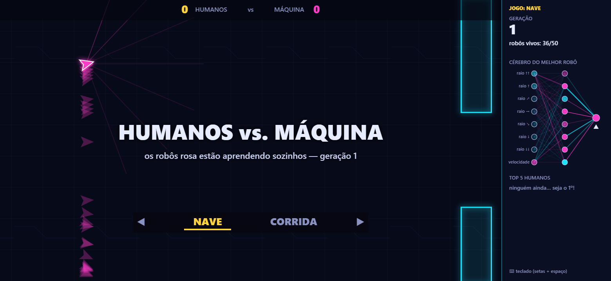
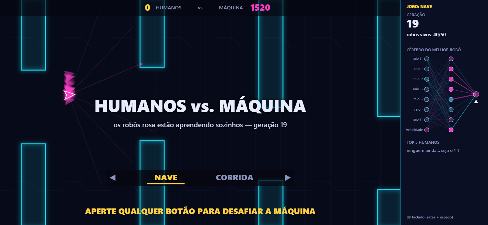

# Humanos vs. Máquina

**Você consegue ganhar de uma IA que está aprendendo na sua frente?**

Três joguinhos de stand para conversar sobre inteligência artificial com o ensino médio.
Enquanto ninguém joga, 50 robôs aprendem sozinhos, geração após geração, por **evolução**
(algoritmo genético + uma rede neural pequena). Qualquer pessoa pega o controle e desafia
a geração atual.

Feito para a conversa sobre tecnologia na **E. E. Firmino Costa** (Lavras/MG), com
os cursos da **UFLA** como pano de fundo.

▶ **Jogar no navegador:** https://bonijoao.github.io/humanos-vs-maquina/

| Geração 1: ninguém sabe nada | Algumas gerações depois |
|---|---|
|  |  |
|  |  |
|  |  |

## Os jogos

**🏎️ Corrida.** Três voltas contra o relógio, e vale o menor tempo. O carro acelera sozinho,
você só vira. Bater na parede só freia. São cinco pistas, e a mesma IA corre em todas, então
dá para trocar de pista e ver a máquina se virando num lugar que ela **nunca viu**.

**🟨 Plataforma.** Uma fase por tela: corra, pule buracos e espinhos e chegue na bandeira
no menor tempo. Morreu? Volta para o começo com o relógio correndo. São três fases de
dificuldade crescente. Os robôs "enxergam" uma grade 5×5 de blocos em volta e decidem
duas coisas, **andar** e **pular**. Na fase 3, os espinhos no teto obrigam a aprender o pulo curto.

**🚀 Nave.** Desvie das colunas, algumas se mexem. Tem gravidade leve: segure ▲ para subir.
Vale a distância.

Em todos, o robô **não vê a tela**. Na corrida e na nave, ele só sabe a distância até a
parede em 7 direções, os riscos rosa que saem do melhor robô, como o sensor de ré de um
carro ou o lidar de um carro autônomo. Na plataforma, ele vê só os blocos ao redor. No painel lateral dá para ver o "cérebro" dele decidindo em tempo real.

## O que dá para conversar

- **Ninguém programou como desviar.** Os robôs começam apertando botões ao acaso, e os
  melhores de cada geração viram "pais" da próxima, com pequenas mutações. É a seleção
  natural aplicada a programas.
- **IA não é só ChatGPT.** Ela também está em recomendação de vídeos, visão computacional,
  agricultura de precisão, saúde e robótica. Os cartões que aparecem entre as partidas
  puxam esses assuntos.
- **Generalização.** O que acontece quando a IA encontra uma pista que nunca viu?
- **Onde estudar isso.** Os cartões também mostram cursos da UFLA.

## Como usar no stand

Abra `index.html` no Chrome, sem internet e sem instalar nada, ou use o link acima.
Aperte **F** para tela cheia.

| Controle (ou teclado) | O que faz |
|---|---|
| qualquer botão / Espaço | começa a partida |
| analógico, direcional / setas | joga |
| ◀ ▶ na tela de espera | troca de jogo |
| ▲ ▼ na tela de espera | troca de pista / fase |

Funciona com controle de Xbox, PlayStation, Switch ou qualquer genérico USB/Bluetooth.

**Teclas do operador:** `1` `2` `3` acelera o treino (×1, ×5, ×20). Segurar `R` por
2 s reseta a IA, bom quando chega uma turma nova. Mais detalhes em [LEIA-ME.txt](LEIA-ME.txt).

Sugestão de roteiro: resetar com a turma olhando, deixar uns minutos em ×1, chamar alguém
para jogar e trocar de pista no final.

## Por dentro

JavaScript puro e Canvas, sem dependências e sem build.

```
src/games/race.js   corrida: física, pistas, sensores
src/games/plat.js   plataforma: fases, física, grade de visão
src/games/drone.js  nave: física, obstáculos, sensores
src/nn.js           rede neural pequena (entradas → 8 → 1 ou 2 saídas)
src/ga.js           algoritmo genético: elite, torneio, mutação
src/main.js         loop, telas, placar
src/cards.js        cartões de curiosidade
```

```bash
npm test                          # testes de unidade (Node ≥ 18)
python tests/browser_check.py     # testes no Chrome (Playwright)
node tools/curve.js race 20 3     # mede a curva de aprendizado
```

Os testes cobrem até a "graça" do jogo: falham se a máquina dominar logo nas primeiras
gerações, porque aí não dá para ver o aprendizado.

---

Também do stand: [**Você é previsível?**](https://github.com/uaipedro/voce-e-previsivel),
jogos curtos contra uma IA sobre probabilidade, dados e informação.
